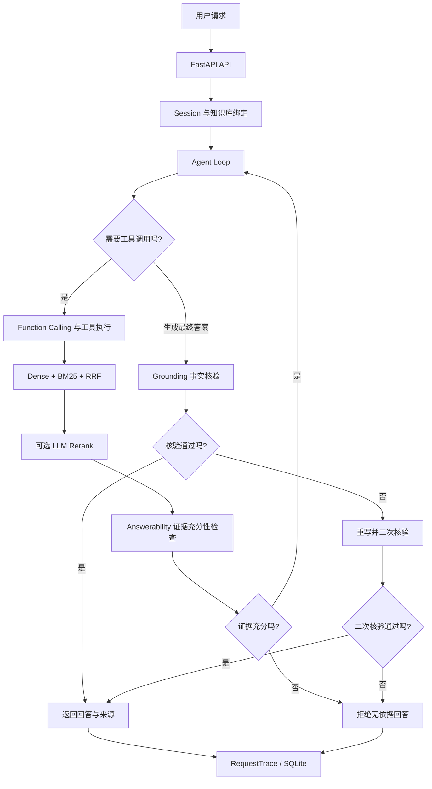

# 基于混合 RAG 与可靠性校验的可配置知识库 Agent

一个基于 Python、Qwen 与 FastAPI 实现的知识库 Agent 实践项目，重点覆盖自定义 Agent Loop、Function Calling、混合检索、回答可靠性校验及多知识库隔离。

> 项目定位：个人学习和工程实践，尚未经过生产环境负载、权限体系或多租户验证。

## 核心能力

- **Agent Loop / Function Calling**：工具注册、参数解析、Python 函数执行、结果回传与 `max_steps` 循环保护；使用 `ToolResult`、`AgentResponse` 组织执行结果。
- **混合 RAG**：Dense + BM25 召回、RRF 融合，支持按知识库配置启用 LLM Rerank 和设定 Top-K。
- **可靠性校验**：Answerability 检验证据是否足以作答；Grounding 逐条核对生成答案中的事实，对不受支持的内容尝试一次重写及二次核验，仍不通过则拒答。
- **多知识库**：`tech` 与 `company` 使用独立的知识源、索引和会话绑定；已通过真实 Qwen 跨库拒答案例。
- **工程化**：FastAPI、Session TTL、会话级锁与 HTTP 409 冲突处理，以及 RequestTrace + SQLite 阶段耗时、Token 和错误记录。

## 技术栈

Python 3.10、Qwen、FastAPI、Dense Retrieval、BM25、RRF、SQLite、Pytest。

## 主要请求流程



此图为知识库问答的主要路径，省略了非检索工具和异常分支。

## 主要目录

```text
agent_core/          Agent Loop、模型调用、结构化响应
rag/                 Dense/BM25/RRF、Rerank、Answerability、Grounding
api/                 FastAPI 与 Session 管理
storage/             SQLite 与 RequestTrace
tools/               工具实现
knowledge/           tech 知识库原始材料
knowledge_bases/     company 知识库原始材料
eval/                评测脚本、数据集与挑战语料
tests/               自动化测试
docs/                设计与评测文档
build_vector_index.py  索引构建入口
```

## 环境配置

建议 Python 3.10。依赖清单需在原项目开发环境生成并在干净环境中复核。

```bash
conda create -n agent python=3.10 -y
conda activate agent
python -m pip install -r requirements.txt
cp .env.example .env
```

编辑 `.env`，填入自己的 API Key。项目如果没有自动加载 `.env`，可在可信的本地 shell 中加载：

```bash
set -a
source .env
set +a
```

### 构建索引

GitHub 版本不上传本地数据库、聊天记录或生成的向量索引。运行 RAG 功能前，请先根据 `rag/knowledge_base_config.py` 的 `tech` / `company` 路径生成各自的索引和 Chunk 文件。

> **待发布前核验**：`build_vector_index.py` 的命令行参数以及 `company` 索引的构建方式。确认后把准确命令补充到此处，勿直接假定单次构建会覆盖两个知识库。

### 启动 API

```bash
python -m uvicorn api.main:app --host 127.0.0.1 --port 8000
```

示例请求（替换开发密钥）：

```bash
curl -X POST http://127.0.0.1:8000/chat \
  -H 'Content-Type: application/json' \
  -H 'X-API-Key: YOUR_DEV_API_KEY' \
  -d '{"message":"请根据知识库解释 RAG"}'
```

## 自动化测试

```bash
python -m pytest tests/ -q -rs \
  --ignore=tests/test_langgraph_function_calling.py \
  --ignore=tests/test_langgraph_function_loop.py \
  --ignore=tests/test_langgraph_tools.py \
  --ignore=tests/test_langgraph_rag.py
```

2026-11-17 开发环境的最近一次结果：**159 passed，1 skipped，0 failed**。跳过原因是 `company` 索引已存在；这不是全新环境测试结果。

## 检索消融实验

采用 `company_dev_v1` 挑战开发集的 14 个可回答问题、16 个标注事实。以下是 **检索阶段** 指标，延迟不包含 Agent 生成和 Grounding。

| 指标 | Hybrid RRF | Hybrid + LLM Rerank |
|---|---:|---:|
| Gold Fact Recall@3 | 93.75% | 93.75% |
| Complete Evidence@3 | 92.86% | 92.86% |
| MRR@3 | 0.929 | 1.000 |
| P50 检索延迟 | 207.45 ms | 4,908.84 ms |

LLM Rerank 提高了首个相关证据的排序，但在这组数据中未增加 Top-3 事实覆盖，且成本和延迟明显更高。原始实验摘要位于本地 `eval/results/ablation/retrieval_ablation_20261117T120408_173107Z.summary.json`；如不公开结果文件，建议将公开版评测摘要写入 `docs/evaluation.md`。

**局限**：标签状态为 `auto_migrated_needs_human_review`，属于待人工复核的开发评测，不能据此声称生产性能。

## 真实演示场景

对于问题“星桥科技员工年假申请至少需要提前多少个工作日？”：

- `company`：回答“至少提前 2 个工作日”，引用 `leave_policy.md::chunk-0`。
- `tech`：明确表示知识库没有足以回答的依据，没有引用 `company` 的制度资料。

本项目也已验证 Grounding 对无依据事实的重写和二次核验。

## 已知限制

- 涉及多个文档的复杂问题可能需要更完整的证据召回。
- LLM Rerank 增加延迟和 Token 消耗。
- 评测集较小、部分标签尚待人工复核。
- 项目面向单机演示，尚未做生产负载、权限体系或多租户验证。

## 发布前检查

- [ ] 在干净环境验证 `requirements.txt` 可安装
- [ ] 补充 `tech` 和 `company` 的索引重建命令
- [ ] 核对所有公开知识库文档和评测数据的授权与隐私
- [ ] 检查 Git 暂存区不包含 `.env`、数据库、Session 历史及备份
- [ ] 补齐架构、评测及演示文档

## 从公开仓库重建知识库索引

公开仓库不包含 `data/` 中的运行数据库、聊天记录和自动生成的索引。
克隆仓库后，先安装 `requirements.txt` 并配置 `.env` 中的 `DASHSCOPE_API_KEY`，然后在项目根目录执行：

```bash
python build_vector_index.py --knowledge-base tech
python build_vector_index.py --knowledge-base company
```

索引分别输出到 `data/rag_index.npz`、`data/rag_chunks.json`，以及
`data/knowledge_bases/company/` 下的对应索引和 Chunk 文件。
首次运行需要访问 Embedding 服务，可能产生 API 调用费用；已经存在的索引无需重复构建。
