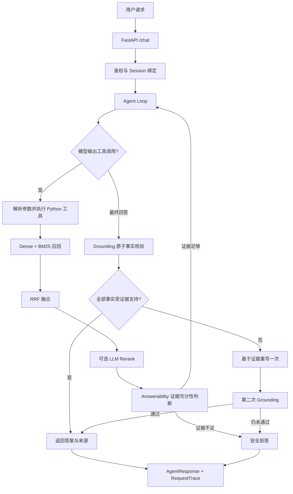

# 系统架构与核心执行链路

> 项目：基于混合 RAG 与可靠性校验的可配置知识库 Agent
> 状态：依据 2026-11-17 已验收源码、测试与真实问答记录整理。

## 1. 目标与设计边界

系统将 Qwen Function Calling、混合检索、证据充分性判断和生成后事实核验串联成一个知识库 Agent。支持技术知识库 `tech` 和虚构企业制度知识库 `company`。项目面向个人学习与工程演示；尚未验证生产级权限、多租户或分布式并发。

## 2. 核心模块

| 模块 | 主要路径 | 职责 |
|---|---|---|
| API 层 | `api/main.py` | 请求鉴权、会话路由、错误与结构化响应、请求追踪 |
| 会话管理 | `api/session_manager.py` | Session TTL、会话级非阻塞锁、知识库绑定 |
| Agent | `agent_core/agent.py` | Agent Loop、Function Calling、工具执行与生成后的核验流程 |
| 结构化响应 | `agent_core/models.py`、`agent_core/response_context.py` | `AgentResponse`、工具调用与证据来源采集 |
| 混合 RAG | `rag/knowledge_base_config.py`、`rag/hybrid_retriever.py` | 多知识库参数、Dense/BM25 召回和 RRF 融合 |
| 可靠性校验 | `rag/grounding_checker.py` 及 Agent 中对应逻辑 | Answerability、Grounding、一次重写与二次核验 |
| 可观测性 | `storage/request_trace.py`、`storage/trace_context.py` | RequestTrace、阶段耗时、Token、异常与 SQLite 持久化 |
| 评测 | `eval/retrieval_ablation.py` 等 | 召回、排序、完整证据率与延迟对比 |

模块名称和文件路径以当前仓库实际代码为准；具体初始化依赖请在发布前再次用源码确认。

## 3. 知识库请求主链路

该图描述知识库问答主路径，省略其他工具分支、网络失败等异常路径。Function Calling 是模型提出的工具调用意图，Agent Loop 才负责实际执行工具、将结果回传模型并决定是否继续。

## 4. 混合检索与配置

在 `rag/knowledge_base_config.py` 中，`tech` 与 `company` 配置不同的原始文档目录、向量索引和 Chunk 文件；默认检索参数如下：

| 参数 | 当前默认值 | 含义 |
|---|---:|---|
| `dense_top_k` | 5 | Dense 候选数 |
| `bm25_top_k` | 5 | BM25 候选数 |
| `rrf_k` | 60 | RRF 融合参数 |
| `top_k` | 3 | 最终保留条数 |
| `rerank_enabled` | `True` | 是否初始化 LLM Reranker |

配置开关和 Top-K 默认值已进行 Mock 运行时验证：关闭 Rerank 不创建重排器；`top_k=2` 返回 2 条；开启时创建重排器。

RRF 用排名而非不同模型的原始分数进行融合，有利于组合语义匹配与关键词匹配；它不能保证每个多事实问题的证据都在 Top-K 内。

## 5. 可靠性与故障处理

**Answerability** 在准备回答前判断检索证据是否足以支持问题；**Grounding** 在生成回答后逐条判断原子事实是否由证据支持。后者不通过时，系统尝试一次基于证据的改写，再次核验；若仍不通过则拒答。只有受支持的证据 Chunk 应进入最终引用。

`ToolResult` 对工具执行结果和错误进行封装；`AgentResponse` 包含业务成功状态、答案、工具记录、来源、错误类型与元数据。请求级执行异常可以触发 HTTP 500；业务层证据不足可以作为正常完成的 HTTP 请求返回 `success=False`。

## 6. Session 与追踪

- Session TTL 默认 1800 秒。过期且未运行中的会话实例可清理。
- 同一个 Session 使用非阻塞请求锁；并发冲突通过 `SessionBusyError` 映射 HTTP 409。不同 Session 的请求锁独立。
- SQLite 持久化 Session 与知识库的绑定，防止同一 Session 在重启后静默切换知识库。
- `RequestTrace.status="success"` 表示 **HTTP/执行请求正常结束**，不代表 Agent 业务成功；`agent_execution.outcome="agent_failure"` 可记录业务失败。
- 可观测阶段包括 `llm_call`、`hybrid_retrieval`、`llm_rerank`、`answerability_check`、`grounding_check`、`grounding_rewrite`、`tool_execution`，以及模型 Token 用量采集。

## 7. 已知工程边界

本项目在单机开发环境中已完成 166 项自动化测试（另有 1 项因已有 company 索引而跳过），并验证了真实 Qwen 的双知识库隔离与拒答。尚未证明全新克隆环境可直接运行、生产级吞吐能力、复杂权限管理或分布式锁的一致性。
